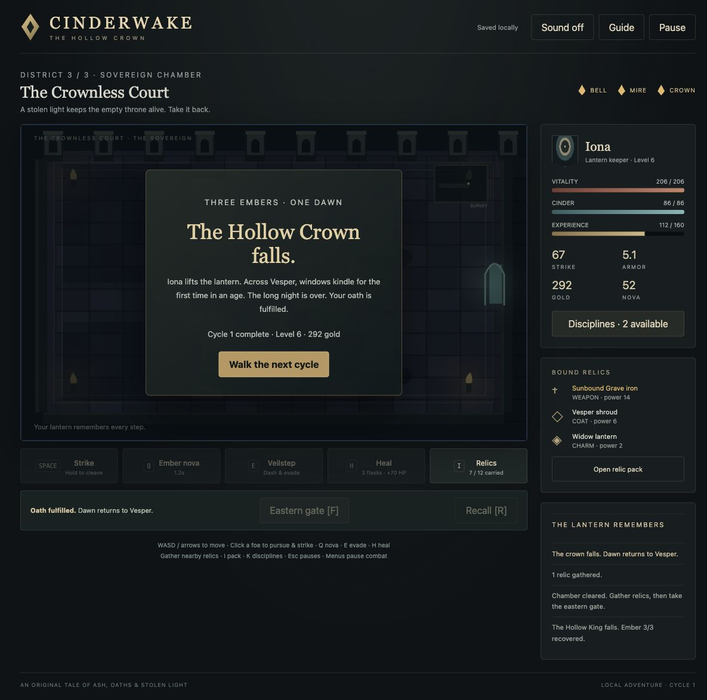

# Cinderwake · The Hollow Crown

An original, compact dark-fantasy action RPG inspired by the exploration, loot, build choices, and recovery rhythm of classic action RPGs. Carry Iona's Cinder Lantern through the Ashen Steps, Drowned Archive, and Crownless Court. Defeat three sovereigns and bring dawn to Vesper.

The field now uses an **isometric following camera** with world-space floor clicks, upright depth-sorted characters and explicit foe selection. It crops the existing chamber around the keeper instead of showing the whole room at once. A clicked foe remains the melee target; a closer foe cannot take its damage instead. Click another foe or open ground to issue a different command.

Six chambers, three enemy archetypes and three distinct bosses; telegraphed real-time combat; randomized common/enchanted/legendary weapons, coats, and charms; twelve-item pack with safe equipment swaps and salvage; three five-rank disciplines; leveling; a sanctuary smith and recovery loop; death/retry; whole-session autosave; campaign ending and stronger repeat cycles. All art is drawn locally; sound effects are original synthesized tones. No accounts, network services, or paid assets.

## Play locally

Requires Node.js 24 and npm. The production server binds only to the loopback interface.

```sh
npm ci
npm run build
npm run play
```

Open **http://127.0.0.1:5189/**. `npm run play` starts a detached, session-only server, records its PID in `.play/server.json`, and logs to `.play/server.log`. Running it again reuses a healthy Cinderwake server on that port; an occupied foreign port is refused. It installs no boot/login tasks. A reboot ends the server.

Restart from this Mac:

```sh
cd /Users/intrepion/Documents/Codex/2026-10-11/task-5/kata-inspired-by-diablo-ii-lord-of-destruction-codex-dot
npm run play
```

If rebuilding after source changes, run `npm run build` and reload Chrome. `npm run dev` is an optional foreground development server on the same port and must not be run alongside the production server. To deliberately stop the owned server, inspect `.play/server.json` and verify the recorded PID still belongs to this repository's `scripts/serve.mjs` before terminating it; never stop an unrelated listener.

## Controls

| Action                | Control                                                       |
| --------------------- | ------------------------------------------------------------- |
| Move                  | WASD/arrows in the view, floor clicks, or directional buttons |
| Pursue and strike     | Click/tap a foe’s upright body                                |
| Strike                | Hold Space or the Strike button                               |
| Ember nova            | Q or visible button; costs 25 cinder                          |
| Veilstep              | E or visible button; evades toward movement/click destination |
| Heal                  | H or visible button; consumes one of three flasks             |
| Gather / next chamber | F or visible button                                           |
| Relics / disciplines  | I / K or visible buttons                                      |
| Return to sanctuary   | R or Recall                                                   |
| Pause / resume        | Escape or Pause / Close                                       |

Rust circles lock the attack location before harm. Move out or Veilstep. Menus pause combat. Recall fully restores health, cinder, and flasks while preserving chamber progress. Death retains relics/XP and retry costs 20% gold. The smith creates a random relic for gold. Better relics and different discipline ranks change your build.

The browser saves on this origin after commands and every two seconds. Reload restores the entire encounter. Changing browser/origin does not transfer saves. A storage error shows a warning. Pause → New keeper opens a confirmation; choosing its final action replaces the saved adventure. The known Chrome QA adventure at the sanctuary in cycle two is preserved. Use a separate coordinated origin for fresh acceptance; do not reset that existing keeper.

## Engineering and evidence

```sh
npm test
npm run typecheck
npm run build
npm audit --audit-level=moderate
```

GitHub Actions runs the same gates. See [design spec](docs/spec.md), [glossary](GLOSSARY.md), [architecture decision](docs/adr/0001-bounded-campaign-and-save.md), [independent review](docs/review.md), and [verification record](docs/verification.md). Game rules are in `src/game.ts`; rendering, audio, and browser orchestration are separate. The shared camera/picking contract is in `src/projection.ts`. [Isometric correction evidence and route guidance](docs/ISOMETRIC-FIDELITY.md) records primary research, recommended defaults, 25 passing domain checks and remaining limits. A complete control-only encounter is supporting evidence. The [completed native first-chamber route](docs/LOCAL_ACCEPTANCE_2026-10-15.md) separately verifies following/input, selected melee, loot/equipment, gate and reload; the six-chamber campaign was not replayed. No commits or pushes were made for this correction.

The image below is historical browser evidence from before the isometric correction; it is not acceptance evidence for the current camera.



## Play online

[Play the hosted game](https://intrepion.github.io/kata-inspired-by-diablo-ii-lord-of-destruction-codex-dot/)
