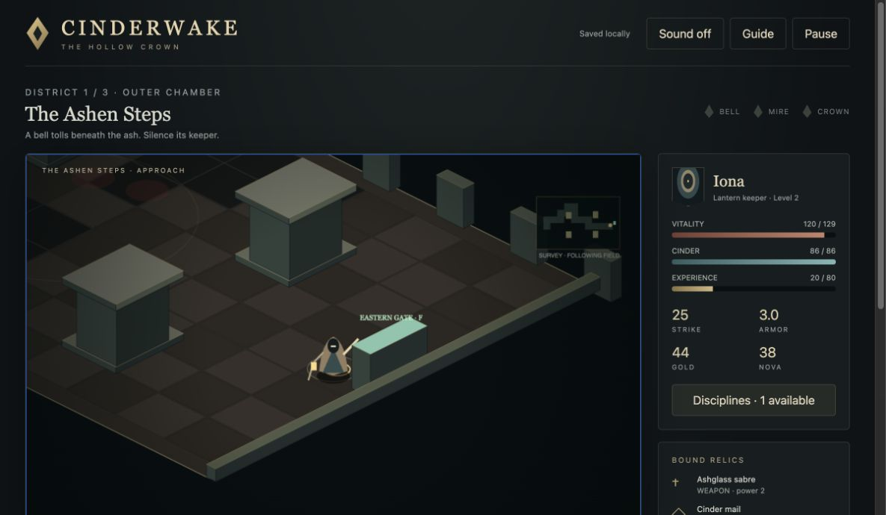

# Diablo following-field native acceptance

2026-10-15, completed before 18:06 UTC. Actual Mac Chrome/intrepion, dedicated QA tab **222225586** at **http://fidelity-diablo-20261015.localhost:5189/**. The existing localhost/127.0.0.1 cycle-two keeper and all other tabs were left untouched. Native visible clicks and physical keys only; accessibility text and returned JPEG pixels supplied observations. No page evaluation, hidden state, injected events or progress mutation.

Candidate: unchanged HEAD `51f4e81db2985c38d10e2749555585c983cf7afb` plus the reviewed local isometric correction, final bundle `index-CZJj2kDQ.js`. The existing **25 tests, strict typecheck, production build and independent final review** had passed; no checks were rerun and no code/build/preview change was needed during acceptance.

## Observed route

- **Fresh/recovery:** Sanctuary showed cycle 1, level 1, 106 vitality, 20 gold, empty pack and original starter equipment. The first live-field inspection ran long enough for enemies to kill the idle keeper. Normal Rekindle returned to the sanctuary with 106 vitality and 16 gold, preserving the encounter. `initial-field.jpg` and `initial-live-inspection-death.jpg` are interim defeat evidence, not successful initial-camera/completion proof. Subsequent active steps were batched with Escape before inspection.
- **Camera, floor and stone:** A native floor click at viewport `(687,527)` moved through the isometric field, with the keeper centered while stone/floor geometry translated. One planned second pixel click near the rendered stone did not produce a conclusive new route; ordinary Right held for 1 second visibly moved past the pillar, and later selected-foe pursuit also navigated around the stone. New floor and foes were exposed instead of shrinking the whole chamber into view. A later visible floor click at `(585,520)` moved the keeper beside the opened eastern gate. These are native pointer/follow/collision observations; numerical inverse accuracy remains separately covered by source tests.
- **Selection and no retarget:** Clicked the visible axe-bearing brute and held Space for 3.5 seconds. It died while the other three health bars remained full; one relic was gathered. Clicked another visible foe, held Space for 1.8 seconds through its death, then held Space another **1.2 seconds without changing command**. The two surviving bars stayed unchanged; the keeper continued taking live enemy damage (68→55 vitality). The paired [before](qa/fidelity-2026-10-15/spent-target-before.jpg) and [after](qa/fidelity-2026-10-15/spent-target-after.jpg) screenshots show the same two full bars, 40 XP and 30 gold. Explicitly clicked a surviving foe and held Space: damage resumed and that foe died. The last selected foe was pursued around stone and defeated. No Nova was used to clear the encounter.
- **Clear/loot/equip:** All four first-room foes defeated; visible `Chamber cleared`, level 2, 120/120 vitality, 44 gold, 20/80 XP and two carried relics. Opened I and equipped the dropped **Cinder mail**, power 5, swapping the starter mantle into the pack. Armor changed **1.2→3.0**, maximum vitality **120→129**; the journal/sidebar named the equipped coat. A Runed Oathstone, power 9, remained carried. The smith fallback was unnecessary.
- **Gate/reload:** Walked with D+S for 2 seconds, then clicked visible floor beside the opened gate. F advanced to **District 1 / Sovereign Chamber — The Bellkeeper**. Reloaded the same QA origin and paused promptly. Sovereign room, equipped Cinder mail, 2 carried items, level 2, 44 gold, 129/129 vitality and cycle 1 all persisted; the journal retained the first-chamber clear/equip. Reopened the pack and confirmed starter mantle plus Runed Oathstone remained carried. Menus/Escape cleared active commands without a stale attack or movement resuming.

## Evidence and limits

Representative native captures are linked below. Additional named captures and the final public accessibility-tree record remain in the local audit bundle.

Accepted scope is one outer chamber's following view, floor commands, pillar traversal, explicit selected melee/dead-target protection, dropped loot/equipment, gate transition and persistence. The next boss was **not fought**; no ember, six-chamber campaign, cycle-two contents, blind identification, exact original camera/physics, narrow viewport, physical touch/gamepad or audible sound result is claimed. The native hold used Space; the Strike-button controller regression remains source evidence. Native pillar traversal used keyboard/selected pursuit; the ambiguous second floor-click attempt is not claimed as successful pointer pathfinding.

No application defect requiring a source fix was established. No source, tests, builds, dependencies, preview processes, security/lock settings, commits or pushes changed. Only QA tab 222225586 was closed, and exclusive browser input was explicitly released to the parent before documentation work. The earlier Mac-lock blocker was superseded by the user's manual unlock and this completed route.

## Included native captures

- [spent-target-before.jpg](qa/fidelity-2026-10-15/spent-target-before.jpg)
- [spent-target-after.jpg](qa/fidelity-2026-10-15/spent-target-after.jpg)
- [eastern-gate-cleared.jpg](qa/fidelity-2026-10-15/eastern-gate-cleared.jpg)
